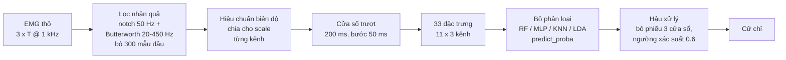
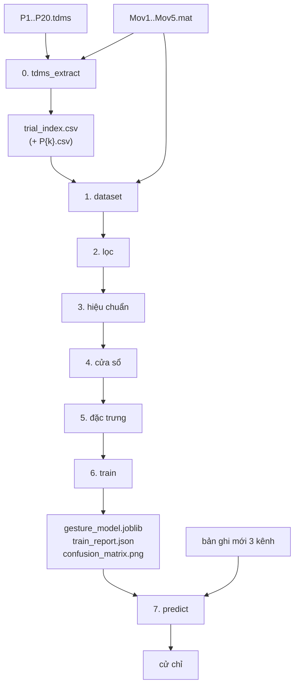

# emg_pipeline – Nhận dạng 5 cử chỉ tay từ sEMG thô 3 kênh

Pipeline huấn luyện và nhận dạng cử chỉ trực tiếp trên dataset Kaggle **DS1_EMG_SIGNALS_AVERAGE**
(20 người, 3 kênh, 1000 Hz, 5 cử chỉ). Không dùng mô phỏng phần cứng; tín hiệu được xử lý ở dạng EMG thô.

Đầu vào: một bản ghi 3 kênh EMG thô 1 kHz (từ file `.mat`, CSV của dataset, hoặc CSV bất kỳ có cột
`channel_1, channel_2, channel_3`). Đầu ra: dòng thời gian quyết định theo từng cửa sổ 200 ms và
**một cử chỉ cuối cùng** cho cả bản ghi.

| Nhãn | Cử chỉ | File gốc |
|---|---|---|
| 0 | Fist (nắm tay) | `Mov1` |
| 1 | Thumb flexion (gập ngón cái) | `Mov2` |
| 2 | Rest (nghỉ) | `Mov3` |
| 3 | Finger extension (duỗi 5 ngón) | `Mov4` |
| 4 | Middle+ring flexion (gập ngón giữa và áp út) | `Mov5` |

---

## 1. Kiến trúc model



### 1.1 Lọc
- Trừ DC (trung bình 300 mẫu đầu), notch IIR 50 Hz (Q = 30), Butterworth bậc 4 thông dải 20–450 Hz,
  ghép thành một chuỗi SOS.
- Lọc **nhân quả** (`sosfilt`), nên kết quả offline giống hệt khi chạy theo luồng thời gian thực.
- 300 mẫu đầu (quá độ của bộ lọc) bị bỏ: mỗi lần lặp 4500 mẫu còn 4200 mẫu.

### 1.2 Hiệu chuẩn biên độ
Biên độ EMG khác nhau nhiều giữa người và phiên đo. Với mỗi người, `scale[c]` là phân vị 95 của RMS
theo cửa sổ trên kênh `c`, tính trên **các lần lặp huấn luyện** của người đó (mọi cử chỉ). Tín hiệu
được chia cho `scale` trước khi trích đặc trưng. Người chưa biết dùng `scale` toàn cục (trung vị qua
các người huấn luyện).

### 1.3 Cửa sổ
`WINDOW = 200` mẫu (200 ms), `STEP = 50` mẫu (50 ms) → 81 cửa sổ cho mỗi lần lặp 4,2 s.
Mỗi 50 ms có một quyết định mới.

### 1.4 Đặc trưng (11 mỗi kênh × 3 kênh = 33)

| Đặc trưng | Ý nghĩa |
|---|---|
| `logMAV`, `logRMS` | Log biên độ trung bình tuyệt đối / căn quân phương |
| `logWL` | Log độ dài dạng sóng (tổng \|x[i+1] − x[i]\|) |
| `ZC` | Số lần qua 0 có biên độ bước ≥ 0,02 |
| `SSC` | Số lần đổi dấu độ dốc vượt ngưỡng 0,0005 |
| `MNF`, `MDF` | Tần số trung bình / trung vị của phổ công suất (đơn vị 100 Hz) |
| `AR1`–`AR4` | Hệ số tự hồi quy bậc 4 (Yule–Walker) |

Ngưỡng ZC/SSC tính trên tín hiệu đã hiệu chuẩn. Tên cột nằm trong `config.FEATURE_NAMES`.

### 1.5 Bộ phân loại

| Tên | Mô hình | Ghi chú |
|---|---|---|
| `lda` | StandardScaler + LinearDiscriminantAnalysis | Tuyến tính, nhẹ nhất |
| `knn` | StandardScaler + KNN (k = 7) | Fit trên 15.000 cửa sổ ngẫu nhiên |
| `rf` | RandomForest 150 cây, `min_samples_leaf = 2` | Fit trên toàn bộ tập huấn luyện |
| `mlp` | StandardScaler + MLP (64, 32), early stopping | Fit trên 15.000 cửa sổ |
| `svm` | StandardScaler + SVC RBF (C = 10) | Tùy chọn, chậm vì phải hiệu chỉnh xác suất |

Mặc định (`--deploy best`), mô hình có **F1 cross-validation cao nhất** được lưu để nhận dạng. Lựa chọn
dựa trên CV của tập huấn luyện, không dựa trên tập kiểm thử.

### 1.6 Hậu xử lý
Với mỗi cửa sổ: nhãn có xác suất lớn nhất được giữ nếu xác suất ≥ `MIN_PROBA = 0.6`, ngược lại bị coi là
"không chắc". Quyết định ổn định = nhãn chiếm đa số trong `VOTE_N = 3` cửa sổ gần nhất; nếu không có đa
số thì giữ quyết định trước. Cử chỉ của cả bản ghi = quyết định ổn định xuất hiện nhiều nhất.

Độ trễ thuật toán ≈ 200 ms (cửa sổ) + 50–100 ms (bỏ phiếu) + thời gian tính toán (cột `ms/window`).

---

## 2. Dữ liệu và vai trò của file TDMS

- `MovK.mat`: mảng `(400, 3, 4500)` – 400 lần lặp của cử chỉ K, mỗi lần 4,5 s.
- `P{k}.tdms`: bản ghi gốc của người `k`; mỗi *group* là một lần lặp ~8,1 s (gồm cả đoạn trước khi làm
  cử chỉ). Lần lặp trong `MovK` chính là đoạn `[3499, 7999)` của một group.

Ghép `MovK` với TDMS (bước 0) cho ra hai kết quả mà file `.mat` không có:
1. **Mã người chính xác** cho từng lần lặp. Giả định "20 lần lặp liên tiếp mỗi người" sai ở 24 lần lặp
   (một số người có 98, 99 hoặc 101 lần lặp).
2. **6 lần lặp trùng nhau nhưng khác nhãn** (cùng một group TDMS xuất hiện trong hai file Mov):
   Mov2 #60 = Mov3 #41, Mov1 #199 = Mov2 #181, Mov3 #400 = Mov4 #381. Các lần lặp này bị loại khi huấn
   luyện (còn 1994 lần lặp).

Bước 0 có thể xuất mỗi file TDMS thành CSV để xem, vẽ đồ thị hoặc làm đầu vào nhận dạng (gồm cả đoạn
trước cử chỉ).

---

## 3. Hướng dẫn sử dụng

Chạy mọi lệnh từ thư mục gốc của repo (thư mục chứa `emg_pipeline/`).

```powershell
python -m pip install -r requirements.txt

# Bước 0: tạo trial_index.csv (mã người cho từng lần lặp); chạy một lần
python -m emg_pipeline.tdms_extract
# (tùy chọn) xuất TDMS ra CSV: người 3, hoặc bỏ số để xuất cả 20 người (~40 MB/người)
python -m emg_pipeline.tdms_extract --export-csv 3

# Bước 1-6: huấn luyện, so sánh mô hình, lưu mô hình tốt nhất
python -m emg_pipeline.train                       # chia theo lần lặp (cùng người)
python -m emg_pipeline.train --split subject       # giữ lại 4 người chưa từng thấy
python -m emg_pipeline.train --models lda rf --deploy lda
python -m emg_pipeline.train --models lda svm      # thêm SVM (chậm)

# Bước 7: nhận dạng một bản ghi
python -m emg_pipeline.predict --mov 1 --trial 97
python -m emg_pipeline.predict --csv csv_data/Mov5.csv --trial 210
python -m emg_pipeline.predict --csv csv_data/tdms/P3.csv --group "Group Name #67" --subject 3
python -m emg_pipeline.predict --csv my_recording.csv              # cần cột channel_1..3, 1 kHz
python -m emg_pipeline.predict --mov 2 --trial 1 --save-input sample.csv
```

Tham số của `predict`:

| Tham số | Ý nghĩa |
|---|---|
| `--mov K --trial N` | Lần lặp N (1–400) của `MovK.mat`; tự biết người và nhãn thật |
| `--csv FILE` | CSV có `channel_1, channel_2, channel_3` ở 1 kHz |
| `--trial N` / `--group NAME` | Chọn một bản ghi khi CSV chứa nhiều bản ghi (`MovK.csv` / `P{k}.csv`) |
| `--subject K` | Dùng hiệu chuẩn của người K. Với `--mov` hoặc `MovK.csv --trial` người được tự suy ra; còn lại mặc định dùng hiệu chuẩn toàn cục |
| `--save-input FILE` | Lưu bản ghi đã đưa vào mô hình |
| `--model FILE` | Dùng file mô hình khác |

Danh sách một số lần lặp **không** dùng để huấn luyện nằm ở `_test_trials_example` trong
`artifacts/emg_pipeline/train_report.json`. Nếu chọn lần lặp đã dùng để huấn luyện, `predict` sẽ in cảnh báo.

Ví dụ: bản ghi TDMS đầy đủ 8,1 s của người 3 (lần lặp kiểm thử Mov4 #46), gồm đoạn nghỉ trước cử chỉ:

```
> python -m emg_pipeline.predict --csv csv_data/tdms/P3.csv --group "Group Name #67" --subject 3
Input: 8100 samples x 3 channels at 1000 Hz (8.10 s)
Calibration: subject 3  scale [0.1149, 0.1019, 0.2193]
Model: RF (split by trial)  windows: 153 x 200 ms, step 50 ms, vote 3, min proba 0.6

Timeline of stable decisions:
   0.50 -  0.50 s  (uncertain)
   0.55 -  2.20 s  Rest
   2.25 -  8.10 s  Finger extension

Recognized gesture: Finger extension  (77% of decisions)
True gesture:       Finger extension  -> CORRECT
```

Thời điểm trên dòng thời gian là thời điểm kết thúc của cửa sổ (đã tính 300 ms quá độ của bộ lọc).

Mọi tham số (bộ lọc, cửa sổ, ngưỡng, tỉ lệ chia, bỏ phiếu) nằm trong `emg_pipeline/config.py`.

---

## 4. Workflow và input/output từng bước



| Bước | Module | Input | Output | Vị trí |
|---|---|---|---|---|
| 0 | `tdms_extract.py` | `P1..P20.tdms`, `Mov1..5.mat` | `trial_index.csv`: `mov, trial, subject, group, start, length` (2000 dòng) | `csv_data/tdms/` |
| 0 (tùy chọn) | `tdms_extract.py --export-csv` | `P{k}.tdms` | `P{k}.csv`: `group, sample, channel_1..3, mov, trial, in_trial` (`mov = 0` nếu group không có nhãn) | `csv_data/tdms/` |
| 1 | `dataset.py` | `Mov1..5.mat`, `trial_index.csv` | `X (n, 3, 4500)`, `y`, `mov`, `trial`, `subject`; cache `dataset_raw.npz`; bỏ 6 lần lặp trùng → n = 1994 | `artifacts/emg_pipeline/` |
| 2 | `processing.filter_emg` | `(…, 3, 4500)` thô | `(…, 3, 4200)` đã lọc | bộ nhớ |
| 3 | `processing.Calibration` | Các bản ghi đã lọc của một người | `scale` 3 giá trị/người; tín hiệu đã chia `scale` | lưu trong model |
| 4 | `processing.sliding_windows` | `(3, 4200)` | `(81, 3, 200)` | bộ nhớ |
| 5 | `processing.extract_features` | `(81, 3, 200)` | `(81, 33)` | bộ nhớ |
| 6 | `train.py` | Đặc trưng + nhãn + nhóm (lần lặp/người) | `gesture_model.joblib`, `train_report.json`, `confusion_matrix.png` | `artifacts/emg_pipeline/` |
| 7 | `predict.py` + `recognizer.py` | Bản ghi `(3, T)` 1 kHz + model | Xác suất `(n_win, 5)` → quyết định `(n_win)` → 1 cử chỉ, in ra màn hình | stdout |

Nội dung `gesture_model.joblib` (dict): `model` (sklearn), `model_name`, `split`, `gestures`,
`feature_names`, `calibrations` (`{subject: [scale × 3]}`), `global_calibration`, `test_trials`
(`[(mov, trial), …]`).

`train_report.json`: với mỗi mô hình có `cv_f1_mean`, `cv_f1_std`, `test_accuracy`, `test_f1_macro`,
`test_voted_accuracy`, `ms_per_window`, `confusion_matrix`; thêm `_deployed` và `_test_trials_example`.

### Cách chia dữ liệu
- `--split trial` (mặc định): 20 % lần lặp của mỗi cặp (người, cử chỉ) làm tập kiểm thử. Mọi người đều
  có trong tập huấn luyện → ước lượng **cùng người** (có hiệu chuẩn trước).
- `--split subject`: 4 người bị giữ lại hoàn toàn và dùng hiệu chuẩn toàn cục → ước lượng
  **người mới, không hiệu chuẩn**.
- CV 5-fold `StratifiedGroupKFold` theo lần lặp (hoặc theo người), để các cửa sổ chồng lấn của cùng một
  lần lặp không rơi vào cả train và validation.

---

## 5. Kết quả

Đo trên 1994 lần lặp (đã bỏ 6 lần lặp trùng), 33 đặc trưng, seed 42. Accuracy/F1 tính theo cửa sổ;
"voted acc" là accuracy sau bỏ phiếu (cửa sổ "không chắc" tính là sai); `ms/window` là thời gian
`predict_proba` cho 1 cửa sổ bằng Python trên PC.

**Cùng người (`--split trial`)** – 1595 lần lặp train / 399 lần lặp test:

| Mô hình | CV F1 | Test acc | Test F1 | Voted acc | ms/window |
|---|---|---|---|---|---|
| LDA | 0,735 ± 0,019 | 0,742 | 0,743 | 0,745 | 0,25 |
| KNN | 0,853 ± 0,017 | 0,864 | 0,865 | 0,887 | 1,3 |
| **RF** (được chọn) | **0,875 ± 0,018** | **0,918** | **0,918** | **0,914** | 6,1 |
| MLP | 0,868 ± 0,015 | 0,896 | 0,896 | 0,903 | 0,14 |

Ma trận nhầm lẫn của RF (hàng = thật, cột = dự đoán, đơn vị cửa sổ):

| | Fist | Thumb | Rest | Extension | Mid+ring |
|---|---|---|---|---|---|
| Fist | 5655 | 195 | 14 | 66 | 550 |
| Thumb flexion | 141 | 5993 | 128 | 86 | 132 |
| Rest | 0 | 103 | 6279 | 17 | 0 |
| Finger extension | 149 | 303 | 15 | 6000 | 13 |
| Middle+ring flexion | 621 | 29 | 0 | 95 | 5735 |

**Người mới (`--split subject`)** – 4 người bị giữ lại, dùng hiệu chuẩn toàn cục
(`train_report_subject_split.json`):

| Mô hình | CV F1 | Test acc | Test F1 | Voted acc |
|---|---|---|---|---|
| LDA | 0,666 ± 0,094 | **0,668** | **0,666** | 0,666 |
| KNN | 0,613 ± 0,049 | 0,628 | 0,621 | 0,633 |
| RF | 0,704 ± 0,081 | 0,641 | 0,632 | 0,631 |
| MLP | 0,642 ± 0,100 | 0,649 | 0,639 | 0,646 |

Nhận xét:
- Khi đã có dữ liệu và hiệu chuẩn của người dùng, RF đạt ~92 %. Lỗi chủ yếu là Fist ↔ Middle+ring
  flexion (~9 % cửa sổ của mỗi lớp).
- Với người mới, mọi mô hình chỉ đạt 63–67 %, và LDA đơn giản tổng quát hóa tốt nhất. Khác biệt giữa người
  là vấn đề chính, không phải độ phức tạp của mô hình.
- File `artifacts/emg_pipeline/gesture_model.joblib` hiện tại là RF từ lần chạy `--split trial`
  (lần chạy sau cùng ghi đè model).

---

## 6. Cấu trúc thư mục

```
emg_pipeline/
  config.py        đường dẫn và mọi tham số
  tdms_extract.py  bước 0: ghép Mov với TDMS, xuất CSV
  dataset.py       bước 1: nạp dữ liệu, mã người, bỏ lần lặp trùng
  processing.py    bước 2-5: lọc, hiệu chuẩn, cửa sổ, đặc trưng
  train.py         bước 6: huấn luyện, đánh giá, lưu model
  recognizer.py    bước 7: bỏ phiếu và nhận dạng
  predict.py       CLI nhận dạng một bản ghi
csv_data/tdms/     trial_index.csv, P{k}.csv
artifacts/emg_pipeline/
  dataset_raw.npz, gesture_model.joblib, train_report.json,
  train_report_subject_split.json, confusion_matrix.png
```

Thư mục `pipeline/` là pipeline cũ (đặc trưng MAV/RMS/WL/ZC, xuất C cho vi điều khiển).
`envelope_pipeline/` là phiên bản mô phỏng KIT0012 trước đây, không còn dùng.

## 7. Hạn chế
- Mỗi lần lặp chỉ chứa một cử chỉ được giữ suốt 4,5 s, nên chưa đánh giá được việc chuyển giữa các cử chỉ.
  Các file `P{k}.csv` có thêm đoạn 3,5 s trước cử chỉ, có thể dùng để thử phần này.
- Fist và Middle+ring flexion hay bị nhầm với nhau vì có cùng nhóm cơ gấp ở cẳng tay.
- Với người mới chưa hiệu chuẩn, độ chính xác giảm mạnh (xem bảng `--split subject`). Để dùng cho người
  mới nên thu một đoạn hiệu chuẩn ngắn và tốt nhất là huấn luyện lại với dữ liệu của họ.
- `ms/window` đo bằng Python trên PC, chưa phải trên vi điều khiển hoặc Raspberry Pi.
